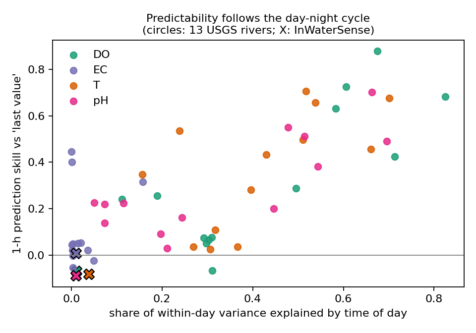
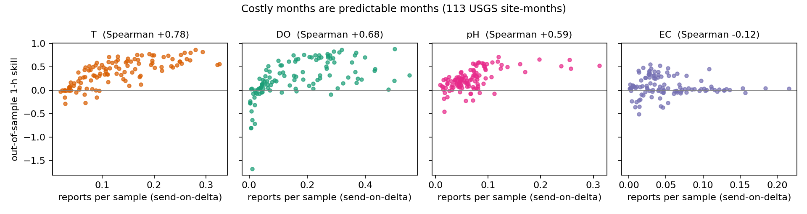
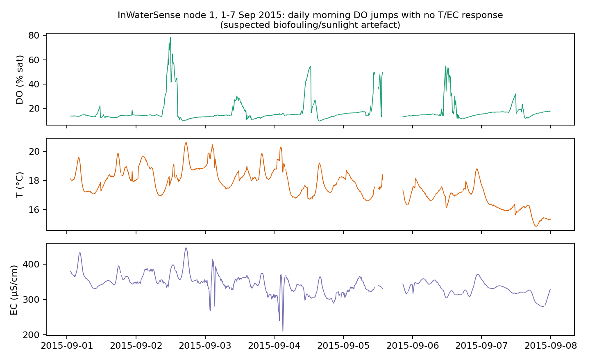

# Phase 1 report: when is water-quality telemetry predictable enough for prediction-based reporting?

*Prepared for Prof K. S. Adu-Manu · 2026-10-03 · Paper 1 (plan v3). All numbers are reproducible from `src/` (scripts named in each section).*

## Why this analysis comes first
In a dual-prediction scheme (DPS), the node stays silent while the server's prediction is within ±δ of the truth. On LPWAN links every report costs ~0.1–4 J, so the energy saved equals the reports avoided. That depends entirely on **how predictable the signal is**. Most DPS papers assume predictability and test on one convenient dataset (mostly Intel Lab; Dias et al. 2016). We measured it first.

## Data
- **InWaterSense node 1** (Sitnica, Kosovo; Libelium Smart Water; 10-min).
  - Rebuilt from raw messages: 19,090 cycles.
  - Only 3–6 cycles actually miss a parameter. The "18% missing" in the published file is a file-assembly artefact.
  - DO is **% saturation** (Libelium's own conversion code; `docs/DO_UNITS_EVIDENCE.md`).
  - pH has week-long probe-fault episodes at pH 2–4, which are flagged.
- **13 USGS river sites, 2023, approved data only** (15-min; two at 5- or 30-min). Selection rule fixed before analysis (`data/raw/usgs/candidate_sites.csv`).
  - One selected site had no 2023 data and was excluded, not replaced.
  - DO %sat was derived from approved mg/L (Benson–Krause). It matches USGS's own %sat at r ≥ 0.99.

## Finding 1: prediction pays on most clean rivers, but not on the Kosovo deployment
1-hour-ahead, out of sample (`src/analysis/check_a.py`, `summarize_check_a.py`):

| Parameter | Rivers where prediction beats "last value" by > 10% | Rivers where adding the other parameters helps (95% CI) | Median error ratio, multi- vs single-parameter |
|---|---|---|---|
| Temperature | 10 / 13 | 9 / 13 | 0.94 |
| Conductivity | 3 / 13 | 3 / 13 | 1.00 |
| DO | 8 / 13 | 7 / 13 | 0.98 |
| **pH** | **11 / 13** | **10 / 13** | **0.81** (best 0.44) |
| **InWaterSense** (all four) | **0 / 4** | **0 / 4** | ≈ 1.0 |

- Cross-parameter information matters most for **pH**, which is coupled to T and DO through photosynthesis and CO₂.
- Conductivity is essentially unpredictable at a 1-h scale everywhere.

## Finding 2: the day–night cycle explains predictability

- Spearman ρ between diel strength and prediction skill = **0.66** across USGS site–parameters (diel strength = share of within-day variance explained by hour of day).
- InWaterSense's diel share is 0.01–0.04, against up to 0.83 in USGS rivers. Its daily signal is buried in sensor noise and artefacts.
- **Tested and rejected:** sensor quantisation does not explain the remaining variation (ρ ≈ ±0.1).
- **Still open:** large, slow rivers (Mississippi, Illinois) are less predictable than their diel strength suggests. Hypothesis: advective, upstream-driven change; would need discharge data.

## Finding 3: costly months are predictable months
Out of sample: each month predicted by models trained only on earlier months, 113 USGS site-months (`src/analysis/seasonal.py`):

| Parameter | ρ(report cost, skill) | Skill in costliest third of months | … in cheapest third |
|---|---|---|---|
| T | +0.78 | 0.61 | 0.07 |
| DO | +0.68 | 0.55 | 0.02 |
| pH | +0.59 | 0.48 | 0.12 |
| EC | −0.12 | 0.02 | 0.07 |

- Summer months with strong diel swings make simple send-on-delta reporting expensive, but they are exactly where prediction helps most.
- In quiet months, prediction can be **worse** than "last value" (DO skill down to −1.7). So a node must **switch predictors adaptively and fall back** to simple reporting.

## Finding 4: events exist everywhere, but InWaterSense events need human review
Offline reference labelling (`src/analysis/check_b.py`):
- Residual after removing level and diel shape; > 5 robust σ, with σ floored at sensor resolution.
- Event ≥ 1 h; glitch < 30 min and reverts.

**USGS:** 1,504 events and 222 glitches.

| Parameter | Median events per 30 days | Median share coinciding with another parameter |
|---|---|---|
| T | 0.8 | 40% |
| EC | 6.5 (storm dilution) | 6% |
| DO | 1.2 | 25% |
| pH | 0 | 67% |

**InWaterSense:** 108 events and 60 glitches. Most strong DO "events" match suspected sensor problems:
- level shifts on 24 Dec and 1 Jan;
- 2–7 Sep 2015: a daily morning DO jump from ~14% to 40–78% saturation, collapsing by mid-afternoon, with **no** temperature or conductivity response. This is consistent with photosynthetic biofouling on the DO membrane (cf. the fouling reported at Weija, Adu-Manu et al. 2020).

## What this means for Paper 1
1. The paper's question becomes **"when does prediction pay, and how should a node adapt?"**, answered across many rivers, rather than "our predictor saves X% on one river" (which would be true on some rivers and false on others).
2. The scheme must be **predictability-aware**: multivariate prediction where it helps (pH, and T/DO on rivers with strong day–night cycles), with fallback to send-on-delta elsewhere. It must keep **hard error bounds** and **event preservation**.
3. Event-preservation evaluation will rely on USGS approved-data events plus injected synthetic events. InWaterSense events need manual adjudication.
4. Energy and lifetime must be computed over **full years**, because report rates vary up to ~40× between months.

## Questions for you
1. **Weija data:** still useful as a second Libelium deployment and for the Ghana angle. Is it available?
2. **The Sitnica DO artefact (Fig. 3):** does it match your experience of fouling on the Libelium DO probe at Weija?
3. **Tolerances δ per parameter:** is there a regulatory or operational reference you would use (Ghana EPA / WHO / EU)?
4. **Venue:** is IEEE Internet of Things Journal acceptable as the primary target?
